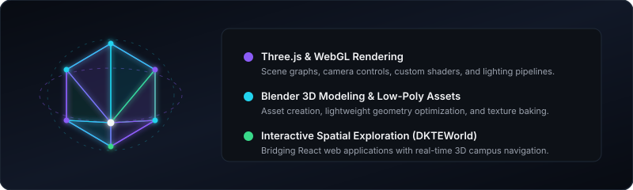
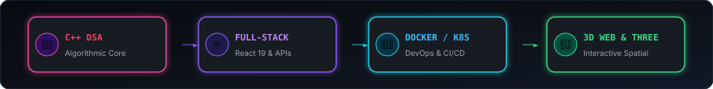
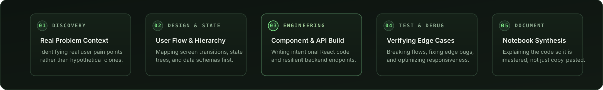

<!-- ================================================================= -->
<!--       M_SWALIYA — FULL-STACK & 3D CREATIVE DEVELOPER PORTFOLIO    -->
<!-- ================================================================= -->

<div align="center">



<br/><br/>

<h1>M_Swaliya</h1>

<h3>Full Stack Developer • Creative Developer • 3D Web Explorer</h3>

<p>
  <strong>Building scalable, user-focused full-stack applications and engineering immersive 3D web experiences that blend modern technology, creative design, and interactive storytelling.</strong>
</p>

<!-- ACTION BADGES & VERIFIED SOCIAL TELEMETRY -->
<p>
  <a href="https://github.com/mujawarswaliya483-sys">
    
  </a>
  &nbsp;
  <a href="mujawarswaliya483gmail.com">
    
  </a>
  &nbsp;
  <a href="https://www.linkedin.com/in/swaliya-mujawar">
    
  </a>
  &nbsp;
  <a href="https://www.leetcode.com/swaliya_mujawar">
    
  </a>
  &nbsp;
  <a href="https://www.hackerrank.com/mujawarswaliya41">
    
  </a>
  &nbsp;
  <a href="https://discord.gg/swaliyamujawar">
    
  </a>
</p>

<p>
  
  &nbsp;
  
  &nbsp;
  
</p>

<br/>


</div>

## 🌌 Developer Identity & Philosophy

I am a second-year Computer Science Engineering student with an ambition that bridges **robust full-stack engineering** and **interactive 3D web experiences**. 

My goal is not merely to build standard web dashboards, but to create **memorable, visually compelling digital products** that fuse performant architecture with spatial computing, real-time animation, and creative coding.

```json
{
  "🧑‍💻 identity": "M_Swaliya (Swaliya Sajid Mujawar)",
  "📍 location": "Maharashtra, India",
  "🎓 degree": "B.Tech Computer Science & Engineering (2nd Year) — DKTE",
  "⚡ core_specialization": "Full-Stack Web Engineering + Interactive 3D Interfaces",
  "🎨 creative_pursuits": "Three.js, WebGL Shaders, Blender 3D Low-Poly Modeling & Motion Design",
  "🛠️ systems_foundation": "C, C++ (OOP & Data Structures), Linux Shell, Docker",
  "🏆 hackathon_lead": "KrishiLens — Agricultural Decision Support (Team AgriSathi)",
  "💬 mantra": "BUILD • LEARN • CREATE • EXPLORE"
}
```

<br/>

<div align="center">
  
</div>

## 🎨 Exploring the 3D Web & Creative Computing

Interactive 3D websites represent the future of web interfaces. I am actively combining my web development foundations with **creative coding, spatial UI, and 3D modeling in Blender**.

<div align="center">
  
</div>

<br/>

<table>
<tr>
<td width="33%" valign="top">

### 🌐 Three.js &amp; WebGL
- Experimenting with camera projections, ambient lighting, and scene graphs in the browser.
- Learning shader fundamentals (`GLSL`) for dynamic visual ripples, particles, and holographic glows.
- Integrating lightweight 3D canvas viewports inside React applications.

</td>
<td width="33%" valign="top">

### 🎨 Blender &amp; 3D Modeling
- Modeling low-poly geometric environments and isometric structures.
- Texture baking, mesh cleanup, and glTF/GLB export optimization for sub-second web load times.
- Rigging simple mechanical assemblies and camera fly-through sequences.

</td>
<td width="33%" valign="top">

### 🏛️ Spatial Web: DKTEWorld
- Architectural concept for an interactive, sketch-styled digital twin of the DKTE college campus.
- Real-time visual navigation through academic departments, labs, and faculty directories.
- Blending Three.js spatial canvases with accessible HTML/React UI overlays.

</td>
</tr>
</table>

<br/>

<div align="center">
  
</div>

## 🛠️ Technical Stack & Capabilities

I prioritize transparency: distinguishing daily working tools from technologies I am actively learning.

### 💻 Core Programming Languages
<p align="left">
  
</p>

- `C++` &amp; `C` — Object-oriented architecture, pointers, memory concepts, algorithmic problem solving.
- `JavaScript (ES6+)` — Asynchronous event loops, functional closures, DOM manipulation.
- `Python` — API prototyping with FastAPI, data manipulation, automation.
- `HTML5` &amp; `CSS3` — Semantic hierarchy, flexbox/grid mechanics, responsive media queries.

### ⚛️ Frontend Architecture
<p align="left">
  
</p>

- `React` (React 19) — Component trees, hooks, custom state machines, unidirectional data flows.
- `Tailwind CSS` (Tailwind v4) — Utility-first styling, design token systems, micro-animations.
- `Vite` — Fast module bundling, HMR, and build optimization.
- `Bootstrap` — Rapid prototyping and responsive grid layouts.

### 🧩 Backend, APIs &amp; Databases
<p align="left">
  
</p>

- `Node.js` &amp; `Express.js` — RESTful API routing, middleware pipelines, error handling.
- `FastAPI (Python)` — High-performance asynchronous endpoints, OpenAPI documentation, model integration.
- `MongoDB` &amp; `Mongoose` — Document schema design, aggregation pipelines, CRUD persistence.
- `MySQL` — Relational table schemas, foreign key constraints, relational queries.

### 🎨 Creative Development &amp; 3D *(Actively Learning &amp; Exploring)*
<p align="left">
  
  &nbsp;
  
  &nbsp;
  
  &nbsp;
  
  &nbsp;
  
</p>

- `Three.js & WebGL` — 3D scene construction, mesh geometry, material lighting, camera movement.
- `Blender` — 3D asset modeling, low-poly environmental sketch designs, glTF pipeline.
- `Motion & Creative Coding` — CSS keyframe physics, canvas particle systems, UI micro-interactions.

### 🔧 DevOps, Cloud &amp; Engineering Tools
<p align="left">
  
</p>

- `Git & GitHub` — Version control, feature branching, pull request workflows.
- `Linux` — Command-line navigation, shell scripting, environment configuration.
- `Docker` *(Basics)* — Containerizing full-stack services, Dockerfile configurations.
- `Kubernetes & CI/CD` *(In Progress)* — Container orchestration concepts, automated testing with GitHub Actions.
- `Postman` — API contract verification, payload testing, endpoint debugging.

<br/>

<div align="center">
  
</div>

## 🚀 Featured Projects

---

### 🌾 01. KrishiLens — Agricultural Crop &amp; Market Decision Support
> *A multilingual decision-support platform designed for Maharashtra farmers to bridge the critical gap between raw weather reports, harvest timing, and optimal market realization.*

```
╔═════════════════════════════════════════════════════════════════════════════╗
║  🌾 KRISHILENS // FLAGSHIP HACKATHON INNOVATION                             ║
║  ─────────────────────────────────────────────────────────────────────────  ║
║  • Role: Team Lead (Team AgriSathi, Hackathon)                              ║
║  • UI: Multilingual Interface in English, Marathi, and Hindi                ║
║  • Backend: Python FastAPI with modular endpoints & Docker configuration     ║
║  • Intelligence: 2017–2026 climate, yield, satellite indices & mandi data   ║
║  • Advisory: Recommends precise harvest windows to prevent unseasonal loss  ║
╚═════════════════════════════════════════════════════════════════════════════╝
```

<table>
<tr>
<td width="65%" valign="top">

#### 🎯 Problem &amp; Challenge
Farmers across Maharashtra frequently lose massive crop value when unexpected rains strike during harvesting or when crops are rushed into oversupplied markets. Standard government portals provide raw weather lists or historical rates, but lack **actionable farm intelligence** that tells a farmer *when* to harvest and *where* to sell.

#### 🛠️ Direct Contribution &amp; Architecture
- **Team Leadership:** Served as Team Lead for Team AgriSathi, orchestrating technical integration between frontend, backend API services, and data models.
- **Full-Stack Development:** Co-engineered the **React/Vite** frontend with an intuitive, low-friction intake form (Taluka, soil type, crop variety) supporting instantaneous toggling between English, Marathi, and Hindi.
- **Backend API Engineering:** Built modular **FastAPI** backend routes (`/advisory`, `/market`, `/options`, `/schemas`) connected with historical datasets and OpenAPI contracts.

#### 🔍 Verified Technology Stack
`Python` • `FastAPI` • `React` • `Tailwind CSS` • `OpenAPI` • `Docker`

</td>
<td width="35%" valign="top">

```yaml
Project: KrishiLens
Role: Team Lead & Full-Stack
Context: Hackathon Innovation
Status: Verified Working Prototype
Domain: Agri-Tech Intelligence
```

<div align="center">

<br/>

<a href="https://github.com/mujawarswaliya483-sys/krishilense">
  
</a>

<br/><br/>


</div>

</td>
</tr>
</table>

---

### 🌿 02. LUMI — Guided Emotional Wellbeing Experience
> *A mindful web application designed around conversational check-ins, intentional support pathways, and calm user flows.*

```
╔═════════════════════════════════════════════════════════════════════════════╗
║  🌿 LUMI // HUMAN-CENTERED INTERACTION ARCHITECTURE                        ║
║  ─────────────────────────────────────────────────────────────────────────  ║
║  • Multi-Screen Flow: Home ➔ CheckIn ➔ Calm / CompanionRequest ➔ Consent    ║
║    ➔ ConnectOutcome ➔ ConversationEnded                                     ║
║  • Built from scratch with React 19 + Tailwind CSS v4                       ║
║  • Zero bloated templates; custom state transition mechanics                ║
║  • Accompanied by in-depth frontend study notebook analyzing component tree ║
╚═════════════════════════════════════════════════════════════════════════════╝
```

<table>
<tr>
<td width="65%" valign="top">

#### 🎯 Problem &amp; Challenge
Most mental health trackers are either sterile clinical logs or basic 1-to-5 emoji meters that leave overwhelmed users isolated. LUMI provides a calm, safe interaction flow that helps someone articulate what they need in the exact moment—grounding breathing techniques or requesting companion support.

#### 🛠️ Direct Contribution &amp; Architecture
- **State Machine Flow:** Architected a 7-stage client state flow using React state transitions without external state library bloat.
- **Modern Component Engineering:** Developed custom reusable UI components using **React 19** and **Tailwind CSS v4** with Lucide icons.
- **Deep Study Documentation:** Maintained `frontend-study-notebook.md` inside the repository to dissect component lifecycles, prop drill mitigation, and state boundaries from first principles.

#### 🔍 Verified Technology Stack
`React 19` • `Tailwind CSS v4` • `Lucide React` • `Vite` • `Oxlint`

</td>
<td width="35%" valign="top">

```yaml
Project: LUMI
Role: Sole Architect & Developer
Status: Active Frontend Prototype
Focus: Empathic UX & State Design
```

<div align="center">

<br/>

<a href="https://github.com/mujawarswaliya483-sys/LUMI">
  
</a>

<br/><br/>


</div>

</td>
</tr>
</table>

---

### 🌐 03. Wondurlust &amp; Web Explorations
> *Learning by building — exploring full-stack web development concepts through practice projects, experimentation, and iterative development.*

- **Wondurlust:** An ongoing learning project focused on understanding full-stack development concepts, including database modeling, server-side rendering, routing, and listing management.
- **Foundation Projects:**  Practice projects exploring JavaScript fundamentals, DOM manipulation, interactive web tools, responsive layouts, and core web development principles..

> *These projects are part of my hands-on learning journey, helping me strengthen my fundamentals and build practical development skills.*

<br/>

<div align="center">
  
</div>

## 🚀 Upcoming Projects &amp; R&amp;D Pipeline

<table>
<tr>
<td width="33%" valign="top">

### 🚌 AI Bus Management System
```
┌─────────────────────────────────┐
│ STATUS: ARCHITECTURE & DESIGN   │
│ DOMAIN: SMART TRANSIT SYSTEMS   │
└─────────────────────────────────┘
```
**An intelligent public &amp; campus transit management system** aimed at eliminating bus delays, overcrowded routes, and schedule uncertainty.

- 📍 **Real-Time Fleet Telemetry:** Live route mapping and automated stop ETA calculation.
- 🧠 **Occupancy &amp; Demand Forecasting:** Machine learning models estimating seat availability based on peak hours and historical ridership.
- ⚡ **Dispatcher Console:** Smart route reallocation during unexpected road delays.
- 🛠️ **Planned Stack:** React, Node.js / Python FastAPI, Leaflet/Mapbox, MongoDB.

</td>
<td width="33%" valign="top">

### 🤖 WebDev AI Assistant Platform
```
┌─────────────────────────────────┐
│ STATUS: PROTOTYPE & R&D         │
│ DOMAIN: DEVELOPER TOOLING       │
└─────────────────────────────────┘
```
**A developer-first AI productivity toolkit** created to accelerate full-stack web development and validate system architecture.

- ⚡ **Contextual Component Scaffolding:** Synthesizes production-ready React 19 / Tailwind components tailored to project design tokens.
- 🛡️ **Schema &amp; API Contract Auditor:** Cross-verifies frontend TypeScript schemas with backend FastAPI/Express routes.
- 🧪 **Accessibility &amp; Linting Inspector:** Automated checks for WCAG compliance.
- 🛠️ **Planned Stack:** Next.js, TypeScript, Tailwind CSS, LLM API integration.

</td>
<td width="33%" valign="top">

### 🏛️ DKTEWorld — Interactive 3D Campus Twin

> *A conceptual exploration of spatial web technology, reimagining campus discovery through immersive 3D visualization and interactive navigation.*

```text
┌─────────────────────────────────┐
│ STATUS: CONCEPT / RESEARCH      │
│ DOMAIN: SPATIAL WEB & 3D         │
└─────────────────────────────────┘
```

An envisioned, sketch-inspired 3D digital representation of the DKTE campus, designed to help prospective students, faculty, and visitors explore campus spaces through an interactive browser-based experience.

- 🗺️ **Interactive Campus Exploration:** Envisioned 3D walkthroughs of academic departments, laboratories, classrooms, and administrative spaces.
- 🔎 **Smart Campus Directory:** A proposed searchable directory for locating faculty offices, lecture rooms, and timetable information.
- 🎨 **Stylized 3D Visual Design:** Exploring a hand-drawn, low-poly aesthetic with lightweight assets and performance-conscious rendering.
- 🛠️ **Proposed Technology Stack:** Three.js, WebGL, React, and Blender.
- 🚀 **Project Vision:** Investigating how interactive 3D environments could make campus navigation more engaging, intuitive, and accessible.

*Currently in the conceptual research stage, with features and implementation details subject to exploration.*


</td>
</tr>
</table>

<br/>

<div align="center">
  
</div>

## 🌌 My GitHub Contributions — Aurora Circuit

This visualization displays my **real, verified GitHub contribution history** retrieved directly from my GitHub profile (`mujawarswaliya483-sys`), layered with the **Aurora Circuit** dynamic energy trail animation.

<div align="center">
  
</div>

- **Truthful Data Representation:** Every square corresponds to my actual contribution count and date range (Oct 2025 – Oct 2026), colored by authentic activity density (from dormant `#161B22` to peak emerald `#39D98A`).

<br/>

<div align="center">
  
</div>

## 🏆 Hackathons &amp; Achievements

Recognizing that real engineering happens when solving non-trivial problems under tight deadlines.

<table>
<tr>
<td width="100%">

### 🥉 3rd Prize — Hackathon Competition
- **Award:** 3rd Prize Winner || mock interview credits
- **Focus:** Demonstrating practical software engineering, rapid problem solving, and effective product delivery.
- **Outcome:** Validated team technical execution, system architecture, and interface design under competitive evaluation.

</td>
</tr>
<tr>
<td width="100%">

### 🎗️ Arambh Hackathon Finalist
- **Recognition:** Finalist Certificate
- **Event:** Arambh Hackathon
- **Contribution:** Advanced to the final evaluation round by conceptualizing and architecting solutions for real-world user challenges.

</td>
</tr>
<tr>
<td width="100%">

### 🌾 KrishiLens — Crop-to-Market Decision Support
- **Context:** Maharashtra Hackathon Innovation Challenge (Team AgriSathi)
- **Role:** Team Lead &amp; Full-Stack Developer
- **Output:** Functional multilingual prototype connecting 2017–2026 climate and mandi datasets to recommend precise harvest dates to Maharashtra farmers.
- **Repository:** [mujawarswaliya483-sys/krishilense](https://github.com/mujawarswaliya483-sys/krishilense)

</td>
</tr>
</table>

<br/>

<div align="center">
  
</div>

## 📜 Certifications &amp; Learning

Maintaining an honest, verifiable record of academic studies, professional coursework, and technical milestones.

- ☁️ **Azure Explore Learning:** Microsoft Azure cloud fundamentals, core cloud concepts, virtualization, and cloud resource architecture.
- 🏅 **Arambh Hackathon Finalist:** Certificate recognizing finalist standing in the Arambh Hackathon innovation competition.
- 🌐 **Web Development:** Comprehensive certification covering core web architecture, frontend responsiveness, and modern full-stack development patterns.
- 🎓 **B.Tech Computer Science &amp; Engineering (Ongoing):** DKTE Society's Textile &amp; Engineering Institute — Focus on Object-Oriented Programming, Data Structures, Operating Systems, Database Management Systems, and Software Engineering.

<br/>

<div align="center">
  
</div>

## 🎯 Current Focus &amp; Learning Roadmap

<div align="center">
  
</div>


1. **Data Structures & Algorithms with C++:** Strengthening problem-solving skills through consistent practice, exploring pointers, memory management, recursion, trees, graphs, dynamic programming, and time and space complexity.

2. **Interactive 3D Web Development:** Exploring Three.js and WebGL to create immersive browser experiences, with a focus on 3D rendering, scene graphs, custom GLSL shaders, and Blender-to-web asset workflows using glTF.

3. **Blender & 3D Content Creation:** Developing skills in 3D modeling, low-poly asset creation, texturing, procedural techniques, and animation optimized for interactive web experiences.

4. **Full-Stack Web Engineering:** Expanding practical knowledge of end-to-end application development, including React, Node.js, Express, and FastAPI, with an emphasis on modular architecture, API integration, maintainability, and responsive user experiences.

5. **Cloud-Native Development & DevOps:** Learning to containerize applications with Docker, understand Kubernetes orchestration, and build automated testing and CI/CD workflows using GitHub Actions.

> *My goal is to turn continuous learning into practical projects, combining strong engineering fundamentals with creative, interactive web experiences.*

<br/>

<div align="center">
  
</div>

## 🔬 How I Build &amp; Learn

I structure my learning systematically. Every major project passes through five deliberate phases:

<div align="center">
  
</div>

<br/>

### 📚 Dedicated Study Repositories
- 💻 **[CPP-basics-and-oop-concepts](https://github.com/mujawarswaliya483-sys/CPP-basics-and-oop-concepts):** Daily problem-solving, C++ OOP implementations, operator overloading, inheritance hierarchies, and memory management.
- 🌐 **[web-dev-journey](https://github.com/mujawarswaliya483-sys/web-dev-journey):** Hands-on modular experiments across frontend layouts, DOM manipulation, asynchronous JavaScript, and backend integration.

**<button></button>
<br/>

<div align="center">
  
</div>

## 📊 GitHub Analytics &amp; Activity Telemetry

<div align="center">

<!-- STREAK STATS -->


<!-- GITHUB STATS -->


</div>

<br/>

<div align="center">

<!-- TOP LANGUAGES -->


</div>

<br/>

<div align="center">
  
</div>

## 🤝 Let's Connect

I am actively seeking **Software Engineering, Full-Stack Web, and Creative Developer internships**, open-source collaboration, and technical mentorship. If you are building innovative web or 3D products, let's talk.

<div align="center">

<a href="mailto:mujawarswaliya483@gmail.com">
  
</a>
&nbsp;&nbsp;
<a href="https://www.linkedin.com/in/swaliya-mujawar">
  
</a>
&nbsp;&nbsp;
<a href="https://github.com/mujawarswaliya483-sys">
  
</a>

<br/><br/>

<p>
  <a href="https://www.leetcode.com/swaliya_mujawar"><strong>LeetCode:</strong> swaliya_mujawar</a> • 
  <a href="https://www.hackerrank.com/mujawarswaliya41"><strong>HackerRank:</strong> mujawarswaliya41</a> • 
  <a href="https://discord.gg/swaliyamujawar"><strong>Discord:</strong> swaliyamujawar</a>
</p>

<br/>

```
╔══════════════════════════════════════════════════════════════════════╗
║                                                                      ║
║   ⭐  If my projects inspire you, consider starring the repos!       ║
║   🤝  Open for SWE internships, full-stack builds & 3D experiments   ║
║   📧  mujawarswaliya483@gmail.com                                    ║
║                                                                      ║
╚══════════════════════════════════════════════════════════════════════╝
```

<br/>

<sub>Crafted with engineering precision, creative curiosity, and a passion for turning ideas into meaningful digital experiences.</sub>

</div>

<!-- END OF README -->
