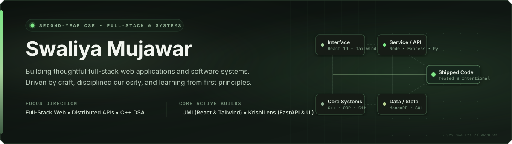

<!-- ================================================================= -->
<!-- SWALIYA MUJAWAR — DEVELOPER PROFILE README                         -->
<!-- Built with deliberate craftsmanship, honest telemetry, and care  -->
<!-- ================================================================= -->

<div align="center">



<br/><br/>

<a href="https://github.com/mujawarswaliya483-sys"></a>
&nbsp;
<a href="https://www.linkedin.com/in/swaliya-mujawar"></a>
&nbsp;
<a href="mailto:mujawarswaliya483@gmail.com"></a>
&nbsp;
<a href="https://github.com/mujawarswaliya483-sys?tab=repositories"></a>

<br/><br/>


</div>

## 🌿 The Approach

I am a second-year Computer Science Engineering student at DKTE with a clear focus: **full-stack web development and software engineering from first principles.**

I do not believe in collecting certificates without substance, nor in generating code I cannot explain. My growth comes from building real applications, mapping out state trees, wrestling with build tools and API boundaries, and maintaining intentional study notebooks as I learn.

- **Current Direction:** Building responsive, accessible user interfaces with React and Tailwind CSS, paired with modular backend services and REST APIs.
- **Foundational Rigor:** Studying object-oriented architecture, memory concepts, and algorithmic problem solving in C++.
- **Near-Term Objective:** Seeking software engineering internships where I can contribute clean code, absorb real-world engineering standards, and build alongside thoughtful mentors.

<br/>

<div align="center">
  
</div>

## 📌 Featured Project Case Studies

Rather than treating projects as bullet points on a résumé, I treat them as engineering case studies. Here is the work that best represents how I think and build.

---

### 01. LUMI — Guided Emotional Wellbeing Experience
> *A web application designed around conversational check-ins, intentional support selection, and calm user flows.*

<table>
<tr>
<td width="65%" valign="top">

#### 🎯 Problem & Motivation
Most mood-tracking software relies on binary numbers or generic emoji pickers that leave users isolated when they are experiencing distress. LUMI was conceived to provide a safe, calm digital space that helps someone identify what kind of support they need in the exact moment they need it—whether that is structured calming techniques or requesting companion support.

#### 🛠️ Direct Contribution & Architecture
- **Interactive Multi-Screen Flow:** Engineered the complete frontend state machine and screen navigation across seven dedicated flow stages: `Home` → `CheckIn` → `Calm` / `CompanionRequest` → `ConnectionConsent` → `ConnectOutcome` → `ConversationEnded`.
- **Component Architecture:** Built reusable, accessible interface components using **React 19** and **Tailwind CSS v4** with zero template boilerplate.
- **Deep Study Documentation:** Maintained a dedicated `frontend-study-notebook.md` alongside the codebase to analyze component lifecycles, prop flows, and state management mechanics to master every design decision independently.

#### 🔍 Technology Stack
`React 19` • `Tailwind CSS v4` • `Lucide React` • `Vite` • `Oxlint`

</td>
<td width="35%" valign="top">

```yaml
Project: LUMI
Stage: Active Frontend Prototype
Focus: Flow State & UX Empathy
Repository: Public
```

<div align="center">

<a href="https://github.com/mujawarswaliya483-sys/LUMI">
  
</a>

<br/><br/>

<sub>*Frontend interaction flow built and verified. Backend connection endpoints planned for subsequent phase.*</sub>

</div>

</td>
</tr>
</table>

---

### 02. KrishiLens — Crop-to-Market Decision Support
> *An agricultural decision-support prototype built for Maharashtra farmers to bridge the gap between raw weather reports and timely harvesting decisions.*

<table>
<tr>
<td width="65%" valign="top">

#### 🎯 Problem & Motivation
Farmers across Maharashtra frequently lose substantial crop yield because raw weather forecasts do not tell them when it is safe to harvest, nor do historical mandi rates provide actionable forecasts for selling windows. KrishiLens was designed to translate multi-year agricultural data (yield, weather patterns, satellite inputs, and market trends) into clear harvest advisories.

#### 🛠️ Direct Contribution & Leadership
- **Team Leadership:** Served as **Team Lead** for Team AgriSathi during the hackathon lifecycle, coordinating responsibilities across UI, backend, and data modeling.
- **Full-Stack Development:** Co-developed the **React/Vite** frontend (including bilingual support in English, Marathi, and Hindi with an accessible Taluka-level intake flow) and contributed to the **Python FastAPI** backend routes (`/advisory`, `/market`, `/options`, `/schemas`).
- **Data Integration:** Built API routes connecting user farm inputs with historical datasets (2017–2026 data models) to provide real-time harvest date recommendations.

#### 🔍 Technology Stack
`Python` • `FastAPI` • `React` • `Tailwind CSS` • `OpenAPI` • `Docker`

</td>
<td width="35%" valign="top">

```yaml
Project: KrishiLens
Role: Team Lead & Full-Stack
Context: Hackathon Innovation
Stage: Functional Prototype
Repository: Public
```

<div align="center">

<a href="https://github.com/mujawarswaliya483-sys/krishilense">
  
</a>

<br/><br/>

<sub>*Prototype developed with Team AgriSathi. Features functional multilingual UI and FastAPI backend contract.*</sub>

</div>

</td>
</tr>
</table>

---

### 03. DKTEWorld — Digital Campus Exploration Concept
> *An ambitious concept for an interactive, sketch-styled spatial digital twin of the DKTE college campus.*

<table>
<tr>
<td width="65%" valign="top">

#### 🎯 Problem & Vision
College campuses can be intimidating and confusing to navigate for incoming students, parents, and visitors. DKTEWorld is an ongoing exploratory concept to create an interactive, hand-drawn sketch-style 3D campus model. Users will be able to navigate visually through departmental buildings, lecture halls, computing laboratories, and faculty cabins to discover locations and room directories.

#### 🛠️ Architectural Plan & Current Study
- **Visual Spatial Canvas:** Exploring **Three.js** and **WebGL** rendering pipelines to render lightweight isometric 3D geometry in the browser without high GPU overhead.
- **Asset Pipeline:** Planning low-poly architectural geometry in **Blender** with a distinct illustrative sketch aesthetic.
- **Frontend Layer:** Designing the accompanying interface controls in **React** for searching rooms, faculty schedules, and interactive points of interest.

#### 🔍 Technologies in Exploration
`React` • `Three.js` • `WebGL` • `Blender (Low-Poly)` • `REST APIs`

</td>
<td width="35%" valign="top">

```yaml
Project: DKTEWorld
Concept: Campus Spatial Twin
Stage: Architectural Design
Status: Research & Modeling
```

<div align="center">


<br/><br/>

<sub>*Developing concept. Focus is currently on WebGL shader fundamentals and spatial user interactions.*</sub>

</div>

</td>
</tr>
</table>

<br/>

<div align="center">
  
</div>

## 🛠️ Technical Capabilities & Foundations

I distinguish clearly between technologies I have built real projects with, versus systems I am actively learning.

| Domain | Daily Working Tools *(Applied in Projects)* | Actively Deepening *(In Progress)* | Long-Term Horizons |
| :--- | :--- | :--- | :--- |
| **Frontend** | React 19, JavaScript (ES6+), HTML5, CSS3, Tailwind CSS | State machines, performance profiling, responsive accessibility | WebGL / Three.js spatial interfaces |
| **Backend &amp; APIs** | RESTful routing, Python (FastAPI endpoints), Node.js fundamentals | Express.js architecture, authentication flows, middleware | Microservices, distributed API design |
| **Data &amp; Storage** | Relational schema basics (SQL), MongoDB document structure | Mongoose ORM, query optimization, indexing | Distributed data stores |
| **Core Systems** | C, C++ (OOP classes, inheritance, pointers), Git &amp; GitHub | Data Structures &amp; Algorithms, time/space complexity | Open-source system contributions, SAP Cloud |
| **Tooling &amp; Workflow**| Vite, Oxlint, VS Code, Linux shell commands, Docker fundamentals | CI/CD GitHub Actions, automated unit testing | Cloud deployment pipelines |

<br/>

<div align="center">
  
</div>

## 🔬 How I Build &amp; Learn

I structure my learning systematically. Every major project passes through five deliberate phases to ensure genuine comprehension:

<div align="center">
  
</div>

<br/>

- **Self-Documented Progression:** In both my [C++ Foundations](https://github.com/mujawarswaliya483-sys/CPP-basics-and-oop-concepts) and [Web Dev Journey](https://github.com/mujawarswaliya483-sys/web-dev-journey) repositories, I maintain daily logs and conceptual notes on OOP, pointer arithmetic, and CSS layout algorithms.
- **Writing to Understand:** In LUMI, I write detailed architectural notes explaining *why* a particular component tree was chosen, ensuring I can defend and refactor any part of my codebase independently.
- **Collaborative Problem Solving:** Through hackathons and team coordination, I focus on clear API contracts, structured branching, and clear communication between frontend and data layers.

<br/>

<div align="center">
  
</div>

## 📚 Study Repositories &amp; Daily Craft

In addition to my featured applications, I maintain focused repositories for structured daily practice:

- 💻 **[CPP-basics-and-oop-concepts](https://github.com/mujawarswaliya483-sys/CPP-basics-and-oop-concepts)** — Daily problem-solving, C++ OOP implementations, operator overloading, inheritance hierarchies, and memory management.
- 🌐 **[web-dev-journey](https://github.com/mujawarswaliya483-sys/web-dev-journey)** — Hands-on modular experiments across frontend layouts, DOM manipulation, asynchronous JavaScript, and backend integration.

<br/>

<div align="center">
  
</div>

## 📬 Let's Connect

I am actively looking for **Software Engineering and Full-Stack Web Development internships**, open-source collaboration, and mentorship opportunities. If you are building something meaningful or would like to discuss my projects, I would love to talk.

<div align="center">

<a href="mailto:mujawarswaliya483@gmail.com">
  
</a>
&nbsp;&nbsp;
<a href="https://www.linkedin.com/in/swaliya-mujawar">
  
</a>
&nbsp;&nbsp;
<a href="https://github.com/mujawarswaliya483-sys">
  
</a>

<br/><br/>

<sub>Crafted with intentionality, clean markup, and genuine enthusiasm for building software.</sub>

</div>
